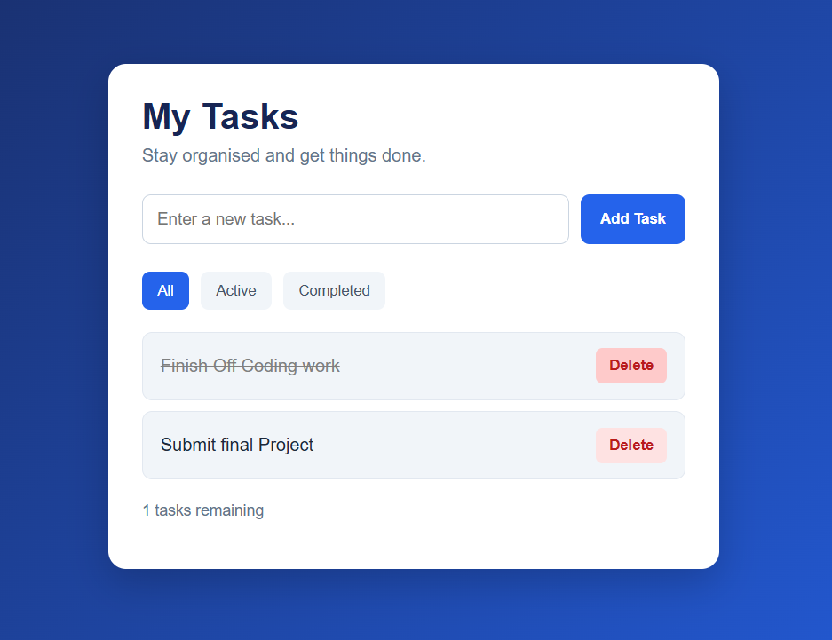

# Task Manager

A browser-based task management application built to practise JavaScript, DOM manipulation and browser-based data storage.

## Features

- Add new tasks
- Mark tasks as completed or active
- Delete tasks
- Filter tasks by All, Active and Completed
- Automatically update the remaining task counter
- Save tasks using browser localStorage
- Retain tasks after refreshing or reopening the browser
- Responsive layout for smaller screens

## Technologies Used

- HTML5
- CSS3
- JavaScript
- Browser localStorage
- Git and GitHub

## How to Run Locally

1. Clone or download this repository.
2. Open `index.html` in a web browser.

No installation or additional dependencies are required.

## What I Learned

- Selecting and updating HTML elements using the DOM
- Handling form submissions and button events
- Working with JavaScript arrays and objects
- Using array methods such as `filter()`
- Creating and updating HTML elements dynamically
- Saving and retrieving data using localStorage
- Testing functionality and debugging JavaScript errors
- Managing and publishing projects using Git and GitHub

## Screenshot

## Live Demo

Coming soon!

## Author

Michael Atano

[GitHub Profile](https://github.com/MichaelAtano)